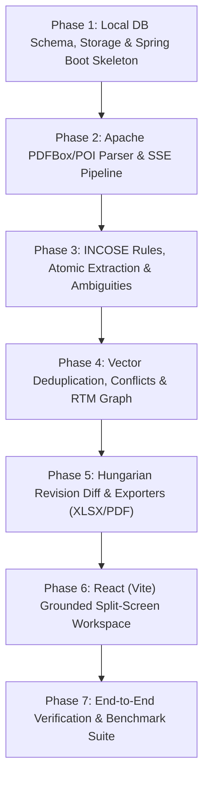

# ReqWise: Automated SRS Analysis & Requirements Intelligence Platform
## Implementation Specification & Execution Plan (React + Java Native Host Edition - No Docker)

> **Notice:** This document serves as the formal implementation blueprint for ReqWise. Recreated per user specification to run **100% directly on the host machine without Docker**:
> - **Frontend:** React 19 / 18 (Vite SPA + TypeScript) running directly via Node.js.
> - **Backend:** Java 21+ & Spring Boot 3.4+ running directly via Maven Wrapper (`mvnw.cmd` / `mvnw`).
> - **Storage:** Local File System Storage Service (`storage_data/` directory on host disk, zero MinIO/S3 container dependency).
> - **Cache & Concurrency:** Spring Boot native in-memory caching and `@Async` ThreadPoolTaskExecutor (zero Redis dependency).
> - **Database:** Local PostgreSQL 16 (with H2 / SQLite in-memory fallback for zero-install instant local development and testing).

---

## 1. Executive Summary & Pure Host Architecture

ReqWise is an enterprise-grade AI-assisted software requirements intelligence platform designed to audit, structure, and validate Software Requirement Specification (SRS) documents before development begins.

### Native Host System Architecture (No Docker):

```text
+-----------------------------------------------------------------------------------------+
|                              LOCAL HOST MACHINE (WINDOWS)                               |
|                                                                                         |
|   +---------------------------------------+   +-------------------------------------+   |
|   |         CLIENT: React 19 (Vite)       |   |     API: Java 21 & Spring Boot      |   |
|   |       http://localhost:5173           |   |       http://localhost:8080         |   |
|   |                                       |   |                                     |   |
|   | - PDF.js Canvas Highlight Overlay     |   | - Apache PDFBox 3.x Layout Parser   |   |
|   | - TanStack Table Virtualized RTM      |   | - Apache POI Word Parser            |   |
|   | - React Flow (@xyflow/react) DAG      |   | - INCOSE Deterministic Rule Engine  |   |
|   | - Monaco Side-by-Side Diff Viewer     |   | - Kuhn-Munkres Hungarian Diff Engine|   |
|   | - Recharts Scorecard Dashboards       |   | - Spring SseEmitter Streaming Engine|   |
|   +-------------------+-------------------+   +------------------+------------------+   |
|                       |                                          |                      |
|                       | REST APIs / SSE Progress Stream          | JDBC Driver          |
|                       +----------------------------------------> |                      |
|                                                                  v                      |
|   +---------------------------------------+   +-------------------------------------+   |
|   |         LOCAL FILE STORAGE            |   |         DATABASE LAYER              |   |
|   |      (d:\ReqWise\storage_data)        |   |    Local PostgreSQL 16 / H2         |   |
|   |                                       |   |                                     |   |
|   | - Raw uploaded PDF & Word documents   |   | - Workspaces, Projects, Documents   |   |
|   | - Generated preview PDFs              |   | - Requirements & Quality Issues     |   |
|   | - Generated XLSX & PDF export packages|   | - Traceability DAG Links & Diffs    |   |
|   +---------------------------------------+   +-------------------------------------+   |
+-----------------------------------------------------------------------------------------+
```

---

## 2. Technology Stack & Tooling Specification

| Layer / Component | Technology & Version | Execution Mode | Purpose & Capabilities |
| :--- | :--- | :--- | :--- |
| **Frontend Framework** | **React 19 / 18 + Vite 6** | **Local Host** (`:5173`) | Modern, modular client-side SPA with ultra-fast Vite HMR and React Router v7. |
| **Frontend Language** | **TypeScript 5.6+** | **Local Host** | Strict compile-time typing matching Spring Boot DTO schemas. |
| **Frontend Styling** | **Tailwind CSS v4 + Shadcn/UI** | **Local Host** | Composable Radix UI primitives (modals, split-panes, badges, virtualized grids). |
| **Document Viewer** | **`react-pdf` (PDF.js) + Canvas** | **Local Host** | Renders SRS pages with synchronized interactive bounding-box highlight layers ($x_0, y_0, x_1, y_1$). |
| **RTM Virtualized Grid**| **TanStack Table v8** | **Local Host** | Virtualized high-performance grid for 1,000+ requirements and traceability records. |
| **Traceability Graph** | **React Flow (`@xyflow/react`) v12** | **Local Host** | Interactive DAG node-edge graph visualizing Business Goals $\rightarrow$ FRs $\rightarrow$ NFRs $\rightarrow$ Tests. |
| **Revision Diff Viewer** | **`@monaco-editor/react`** | **Local Host** | Side-by-side token and semantic diff highlighting across document revisions. |
| **State Management** | **TanStack Query v5 + Zustand** | **Local Host** | TanStack Query for server caching; Zustand for active PDF highlights and split-pane state. |
| **Backend Core** | **Spring Boot 3.4+ (Java 21+)** | **Local Host** (`:8080`) | Enterprise REST API, Spring Data JPA, Hibernate, Spring Validation, OpenAPI 3. |
| **Build & Run Tool** | **Maven Wrapper (`mvnw.cmd` / `mvnw`)**| **Local Host** | Self-contained, portable Java build and runtime launcher (no pre-installed Maven required). |
| **Real-Time Streaming** | **Spring `SseEmitter`** | **Local Host** | Server-Sent Events streaming live analysis pipeline progress ($0\text{--}100\%$) to React UI. |
| **Asynchronous Engine** | **Spring `@Async` TaskExecutor** | **Local Host** | Native ThreadPoolTaskExecutor decoupling heavy PDF parsing and LLM calls from HTTP threads. |
| **In-Memory Cache** | **Spring Cache / ConcurrentMap** | **Local Host** | Lightweight in-process caching for active analysis sessions and pipeline state. |
| **File Storage Service**| **Local Disk Storage (`storage_data/`)**| **Local Host** | Direct filesystem file storage and download endpoints without MinIO/S3 containers. |
| **PDF Layout Parser** | **Apache PDFBox 3.x** | **Local Host** | Extracts text spans, font metrics, hierarchical sections, and coordinates ($x_0, y_0, x_1, y_1$). |
| **DOCX Document Parser**| **Apache POI (`poi-ooxml`)** | **Local Host** | Parses Word XML structures, section headings (`Heading 1`–`Heading 6`), and tables. |
| **Linguistic Rules** | **Java Rule Engine / OpenNLP** | **Local Host** | Implements INCOSE R03 (passive voice), R07 (vague terms), R12 (weak modals). |
| **LLM & Structured Outputs**| **Spring AI / Jackson Client** | **Local Host** | Structured JSON outputs for atomic requirements, FR/NFR classification, and rewrites. |
| **Revision Diff Matching**| **Hungarian Algorithm (Kuhn-Munkres)**| **Local Host** | Bipartite matching on embedding similarity matrix to align shifted requirement IDs. |
| **Report Exporters** | **Apache POI + OpenHTMLtoPDF** | **Local Host** | Multi-tab `.xlsx` RTM workbook with conditional formatting and print-ready PDF executive reports. |
| **Database Layer** | **PostgreSQL 16 / H2 (dev/test)** | **Local Host** (`:5432`) | Stores workspaces, documents, requirements, issues, RTM links, and diffs. |

---

## 3. Target Monorepo File Structure

```text
d:\ReqWise\
├── storage_data\                                 # Local filesystem storage for uploads & exports
│   ├── raw_documents\                            # Uploaded PDF and DOCX files
│   ├── previews\                                 # Normalized PDF previews
│   └── exports\                                  # Generated XLSX and PDF reports
├── apps\
│   ├── web\                                      # React 19 (Vite) + TypeScript Frontend (Host)
│   │   ├── src\
│   │   │   ├── main.tsx                          # React entry point
│   │   │   ├── App.tsx                           # Router container & providers
│   │   │   ├── router\
│   │   │   │   └── index.tsx                     # Route definitions (/dashboard, /documents/:id, etc.)
│   │   │   ├── pages\
│   │   │   │   ├── DashboardPage.tsx             # Executive scorecard, readiness index, project list
│   │   │   │   ├── ProjectDetailPage.tsx         # Document versions list & upload dropzone
│   │   │   │   ├── DocumentViewerPage.tsx        # Split-screen: PDF canvas + Quality Audit panel
│   │   │   │   ├── RtmPage.tsx                   # TanStack virtualized table + React Flow DAG
│   │   │   │   └── RevisionDiffPage.tsx          # Monaco side-by-side version comparison
│   │   │   ├── components\
│   │   │   │   ├── ui\                           # Composable UI components (Button, Dialog, Card, Badge...)
│   │   │   │   ├── layout\                       # Navbar, Sidebar, AppShell
│   │   │   │   ├── pdf-annotator\
│   │   │   │   │   ├── PdfViewer.tsx             # PDF.js document renderer
│   │   │   │   │   └── CanvasHighlightOverlay.tsx# Bounding-box highlight layer
│   │   │   │   ├── requirements\
│   │   │   │   │   ├── RequirementCard.tsx       # Individual requirement card with clarity badge
│   │   │   │   │   ├── RequirementList.tsx       # Filterable requirements list
│   │   │   │   │   └── RewriteModal.tsx          # AI suggested rewrite acceptance & editor
│   │   │   │   ├── issues\
│   │   │   │   │   ├── IssueCard.tsx             # Ambiguity, missing metric, or conflict alert
│   │   │   │   │   └── ConflictComparison.tsx    # Side-by-side contradiction resolver
│   │   │   │   ├── rtm\
│   │   │   │   │   ├── RtmTable.tsx              # Virtualized TanStack Table
│   │   │   │   │   └── RtmFlowGraph.tsx          # React Flow DAG dependency graph
│   │   │   │   ├── diff\
│   │   │   │   │   ├── DiffSummaryCard.tsx       # Added, deleted, modified breaking badges
│   │   │   │   │   └── MonacoDiffViewer.tsx      # Side-by-side Monaco comparison
│   │   │   │   └── reports\
│   │   │   │       ├── ScorecardCharts.tsx       # Recharts FR/NFR and defect breakdown
│   │   │   │       └── ExportActions.tsx         # XLSX & PDF export trigger buttons
│   │   │   ├── lib\
│   │   │   │   ├── api.ts                        # Axios/Fetch client connecting to http://localhost:8080
│   │   │   │   ├── store.ts                      # Zustand store for active highlights & selected req
│   │   │   │   └── types.ts                      # TypeScript interfaces matching backend DTOs
│   │   │   └── index.css                         # Tailwind CSS styling
│   │   ├── index.html
│   │   ├── package.json
│   │   ├── tsconfig.json
│   │   └── vite.config.ts                        # Proxy configured to http://localhost:8080
│   └── api\                                      # Java 21+ Spring Boot 3.4+ Backend (Host)
│       ├── pom.xml                               # Maven build file with all dependencies
│       ├── mvnw.cmd                              # Maven Windows Wrapper
│       ├── mvnw                                  # Maven Unix Wrapper
│       ├── .mvn\wrapper\                         # Maven Wrapper jar & properties
│       └── src\
│           ├── main\
│           │   ├── java\com\reqwise\
│           │   │   ├── ReqWiseApplication.java   # Spring Boot Application entrypoint
│           │   │   ├── config\                   # Configuration beans
│           │   │   │   ├── AppConfig.java        # General settings & file paths
│           │   │   │   ├── AsyncConfig.java      # ThreadPoolTaskExecutor for async pipeline
│           │   │   │   ├── CorsConfig.java       # Allows requests from http://localhost:5173
│           │   │   │   ├── LocalStorageConfig.java# Local disk storage configuration
│           │   │   │   └── OpenApiConfig.java    # Swagger UI at /swagger-ui.html
│           │   │   ├── controller\               # REST Controllers
│           │   │   │   ├── WorkspaceController.java  # /api/v1/workspaces, /api/v1/projects
│           │   │   │   ├── DocumentController.java   # /api/v1/documents, upload, file download
│           │   │   │   ├── AnalysisController.java   # /api/v1/versions/{id}/analyze & SSE /stream
│           │   │   │   ├── RequirementController.java# /api/v1/requirements (filter, patch rewrites)
│           │   │   │   ├── IssueController.java      # /api/v1/issues (ambiguities, conflicts)
│           │   │   │   ├── RtmController.java        # /api/v1/versions/{id}/rtm & /summary
│           │   │   │   ├── DiffController.java       # /api/v1/documents/{id}/compare
│           │   │   │   └── ExportController.java     # /api/v1/versions/{id}/export (XLSX, PDF)
│           │   │   ├── model\                    # JPA Entities (8 tables)
│           │   │   │   ├── Workspace.java
│           │   │   │   ├── Project.java
│           │   │   │   ├── Document.java
│           │   │   │   ├── DocumentVersion.java
│           │   │   │   ├── Requirement.java      # Includes bounding box coordinates & vector
│           │   │   │   ├── RequirementIssue.java
│           │   │   │   ├── TraceabilityLink.java
│           │   │   │   └── RequirementDiff.java
│           │   │   ├── repository\               # Spring Data JPA Repositories
│           │   │   │   ├── WorkspaceRepository.java
│           │   │   │   ├── ProjectRepository.java
│           │   │   │   ├── DocumentRepository.java
│           │   │   │   ├── DocumentVersionRepository.java
│           │   │   │   ├── RequirementRepository.java # Custom similarity queries
│           │   │   │   ├── RequirementIssueRepository.java
│           │   │   │   ├── TraceabilityLinkRepository.java
│           │   │   │   └── RequirementDiffRepository.java
│           │   │   ├── dto\                      # Request & Response DTOs
│           │   │   │   ├── request\...
│           │   │   │   └── response\...
│           │   │   └── service\                  # Domain Business Logic
│           │   │       ├── parser\
│           │   │       │   ├── DocumentParser.java
│           │   │       │   ├── PdfLayoutParser.java  # Apache PDFBox text & bbox extractor
│           │   │       │   └── DocxLayoutParser.java # Apache POI document parser
│           │   │       ├── quality\
│           │   │       │   ├── LinguisticRuleEngine.java # INCOSE weak modals, vague terms, passive voice
│           │   │       │   └── LlmRequirementAuditor.java# Atomic decomposition & ISO 25010 classifier
│           │   │       ├── embedding\
│           │   │       │   └── EmbeddingService.java     # Vector generation (1536 dims)
│           │   │       ├── conflict\
│           │   │       │   └── ConflictEngine.java       # Cosine candidate search + pairwise LLM check
│           │   │       ├── rtm\
│           │   │       │   ├── RtmLinkerService.java     # DAG linker, orphan & gap detector
│           │   │       │   └── ExecutiveScorecardService.java
│           │   │       ├── diff\
│           │   │       │   ├── HungarianAlgorithm.java   # Kuhn-Munkres bipartite optimal matcher
│           │   │       │   └── VersionDiffService.java   # Shifted ID alignment & impact propagation
│           │   │       ├── storage\
│           │   │       │   ├── StorageService.java       # Storage interface
│           │   │       │   └── LocalStorageService.java  # Pure local disk file operations
│           │   │       ├── exporter\
│           │   │       │   ├── XlsxExporterService.java  # Apache POI multi-tab RTM workbook
│           │   │       │   └── PdfExporterService.java   # Executive Audit Report PDF
│           │   │       └── pipeline\
│           │   │           ├── PipelineOrchestrator.java # Async multi-stage execution
│           │   │           └── SseNotificationService.java# SseEmitter broadcast manager
│           │   └── resources\
│           │       ├── application.yml           # Database connection & local storage path
│           │       └── db\migration\
│           │           └── V1__initial_schema.sql# Database tables initialization script
│           └── test\
│               └── java\com\reqwise\             # JUnit 5 & Mockito test suite
└── docs\                                         # System Architecture & Specifications
```

---

## 4. Database Schema Specification

The schema directly implements Section 4 of `docs/system_architecture_data_design.md` for local database storage:

```sql
-- 1. Workspaces & Projects
CREATE TABLE workspaces (
    id UUID PRIMARY KEY,
    name VARCHAR(255) NOT NULL,
    created_at TIMESTAMP WITH TIME ZONE NOT NULL DEFAULT CURRENT_TIMESTAMP
);

CREATE TABLE projects (
    id UUID PRIMARY KEY,
    workspace_id UUID NOT NULL REFERENCES workspaces(id) ON DELETE CASCADE,
    name VARCHAR(255) NOT NULL,
    description TEXT,
    created_at TIMESTAMP WITH TIME ZONE NOT NULL DEFAULT CURRENT_TIMESTAMP
);

-- 2. Documents & Versions
CREATE TABLE documents (
    id UUID PRIMARY KEY,
    project_id UUID NOT NULL REFERENCES projects(id) ON DELETE CASCADE,
    title VARCHAR(255) NOT NULL,
    created_at TIMESTAMP WITH TIME ZONE NOT NULL DEFAULT CURRENT_TIMESTAMP
);

CREATE TABLE document_versions (
    id UUID PRIMARY KEY,
    document_id UUID NOT NULL REFERENCES documents(id) ON DELETE CASCADE,
    version_number INT NOT NULL,
    version_label VARCHAR(64) NOT NULL,
    source_file_path TEXT NOT NULL,
    preview_pdf_path TEXT,
    file_type VARCHAR(16) NOT NULL CHECK (file_type IN ('PDF', 'DOCX')),
    processing_status VARCHAR(32) NOT NULL DEFAULT 'QUEUED',
    overall_quality_score NUMERIC(5,2),
    executive_summary TEXT,
    created_at TIMESTAMP WITH TIME ZONE NOT NULL DEFAULT CURRENT_TIMESTAMP,
    UNIQUE (document_id, version_number)
);

-- 3. Extracted Atomic Requirements
CREATE TABLE requirements (
    id UUID PRIMARY KEY,
    version_id UUID NOT NULL REFERENCES document_versions(id) ON DELETE CASCADE,
    req_code VARCHAR(64) NOT NULL,
    section_path VARCHAR(255),
    raw_text TEXT NOT NULL,
    normalized_text TEXT NOT NULL,
    req_type VARCHAR(32) NOT NULL CHECK (req_type IN ('FUNCTIONAL', 'NON_FUNCTIONAL', 'CONSTRAINT')),
    nfr_category VARCHAR(64),
    ears_pattern VARCHAR(64),
    priority VARCHAR(32),
    clarity_score NUMERIC(5,2) NOT NULL DEFAULT 100.0,
    page_number INT,
    bounding_box TEXT, -- JSON string: {"x0": 72.1, "y0": 140.5, "x1": 520.0, "y1": 168.2}
    embedding TEXT,    -- Comma-separated or JSON array of 1536 float values
    review_status VARCHAR(32) NOT NULL DEFAULT 'PENDING',
    created_at TIMESTAMP WITH TIME ZONE NOT NULL DEFAULT CURRENT_TIMESTAMP
);

CREATE INDEX idx_requirements_version ON requirements(version_id);

-- 4. Quality Defects (Ambiguities, Duplicates, Conflicts, Incomplete)
CREATE TABLE requirement_issues (
    id UUID PRIMARY KEY,
    version_id UUID NOT NULL REFERENCES document_versions(id) ON DELETE CASCADE,
    primary_req_id UUID NOT NULL REFERENCES requirements(id) ON DELETE CASCADE,
    related_req_id UUID REFERENCES requirements(id) ON DELETE SET NULL,
    issue_category VARCHAR(32) NOT NULL CHECK (
        issue_category IN ('AMBIGUOUS', 'INCOMPLETE', 'MISSING_METRIC', 'DUPLICATE', 'CONFLICT', 'MISSING_REQUIREMENT')
    ),
    severity VARCHAR(16) NOT NULL CHECK (severity IN ('CRITICAL', 'HIGH', 'MEDIUM', 'LOW')),
    flagged_phrase TEXT,
    explanation TEXT NOT NULL,
    suggested_rewrite TEXT,
    similarity_score NUMERIC(5,4),
    is_resolved BOOLEAN NOT NULL DEFAULT FALSE,
    created_at TIMESTAMP WITH TIME ZONE NOT NULL DEFAULT CURRENT_TIMESTAMP
);

-- 5. Requirement Traceability Matrix (RTM) Links
CREATE TABLE traceability_links (
    id UUID PRIMARY KEY,
    version_id UUID NOT NULL REFERENCES document_versions(id) ON DELETE CASCADE,
    source_node_id UUID NOT NULL REFERENCES requirements(id) ON DELETE CASCADE,
    target_node_id UUID NOT NULL REFERENCES requirements(id) ON DELETE CASCADE,
    link_type VARCHAR(32) NOT NULL CHECK (
        link_type IN ('REFINES', 'DEPENDS_ON', 'CONSTRAINS', 'VERIFIED_BY')
    ),
    confidence_score NUMERIC(5,4) NOT NULL,
    is_human_verified BOOLEAN NOT NULL DEFAULT FALSE,
    UNIQUE (source_node_id, target_node_id, link_type)
);

-- 6. Revision Tracking & Semantic Diffs
CREATE TABLE requirement_diffs (
    id UUID PRIMARY KEY,
    document_id UUID NOT NULL REFERENCES documents(id) ON DELETE CASCADE,
    base_version_id UUID NOT NULL REFERENCES document_versions(id) ON DELETE CASCADE,
    target_version_id UUID NOT NULL REFERENCES document_versions(id) ON DELETE CASCADE,
    base_req_id UUID REFERENCES requirements(id) ON DELETE SET NULL,
    target_req_id UUID REFERENCES requirements(id) ON DELETE SET NULL,
    change_type VARCHAR(32) NOT NULL CHECK (
        change_type IN ('UNCHANGED', 'MODIFIED_EDITORIAL', 'MODIFIED_BREAKING', 'ADDED', 'DELETED')
    ),
    similarity_score NUMERIC(5,4),
    impact_summary TEXT,
    impacted_req_ids TEXT DEFAULT '[]',
    created_at TIMESTAMP WITH TIME ZONE NOT NULL DEFAULT CURRENT_TIMESTAMP
);
```

---

## 5. Execution Workflows

### Option A: Local Host Native Execution (Zero Docker)

#### Step 1: Start Spring Boot Backend on Host
```powershell
cd d:\ReqWise\apps\api
.\mvnw.cmd spring-boot:run
```
* Backend starts at `http://localhost:8080`
* Files uploaded are saved directly to `d:\ReqWise\storage_data\`
* Interactive Swagger UI documentation is available at `http://localhost:8080/swagger-ui.html`
* Health check: `http://localhost:8080/api/v1/health`

#### Step 2: Start React Frontend on Host
```powershell
cd d:\ReqWise\apps\web
npm install
npm run dev
```
* Vite SPA starts at `http://localhost:5173`
* Proxies all `/api` requests directly to `http://localhost:8080`

### Option B: Single-Command Containerized Execution (Docker Compose)

Launch the entire ecosystem (PostgreSQL 16, Spring Boot API, and Nginx/React SPA) with a single command:
```bash
docker-compose up --build
```
* **Frontend Web App:** `http://localhost:5173` (Served via Nginx Alpine with real-time SSE streaming proxy)
* **Backend REST API:** `http://localhost:8080`
* **Swagger Documentation:** `http://localhost:8080/swagger-ui.html`
* **PostgreSQL 16:** `localhost:5432` (database: `reqwise`, user: `postgres`, password: `postgres`)
* **Persistent Disk Storage:** Automatically bind-mounted to `./storage_data/` on the host machine.

---

## 6. Phased Implementation Roadmap



### Phase 1: Local Data Layer, Storage & Spring Boot Backend Skeleton [COMPLETED & VERIFIED]
- **Deliverables:**
  1. `storage_data/` directory structure initialization for local file storage.
  2. Spring Boot 3.4+ project scaffolding in `apps/api/` with `pom.xml`, Maven Wrapper (`mvnw.cmd`), and `application.yml` configured for local database.
  3. JPA Entity models for all 8 tables (`Workspace`, `Project`, `Document`, `DocumentVersion`, `Requirement`, `RequirementIssue`, `TraceabilityLink`, `RequirementDiff`).
  4. Spring Data JPA Repositories.
  5. `LocalStorageService` for reading and writing files directly to `storage_data/`.
  6. Base controllers (`WorkspaceController`, `HealthController`) with OpenAPI 3 documentation.
- **Milestone:** Spring Boot backend compiles and runs via `.\mvnw.cmd spring-boot:run`, creates tables, and serves `GET /api/v1/health` with `status: healthy`.

### Phase 2: Document Ingestion, PDFBox/POI Parsing & SSE Pipeline [COMPLETED & VERIFIED]
- **Deliverables:**
  1. `PdfLayoutParser`: Uses **Apache PDFBox 3.x** to extract text blocks, preserve hierarchical sections (`1.0` $\rightarrow$ `1.2`), capture bounding boxes ($x_0, y_0, x_1, y_1$), and filter headers/footers.
  2. `DocxLayoutParser`: Uses **Apache POI (`poi-ooxml`)** for Word document structures.
  3. `SseNotificationService`: Manages Spring `SseEmitter` instances for streaming real-time stage progress ($0\text{--}100\%$).
  4. Document upload & version management endpoints (`POST /api/v1/projects/{id}/documents/upload`, `GET /api/v1/versions/{id}/stream`).
- **Milestone:** Upload an SRS file and verify parsed sections and bounding boxes stream via Server-Sent Events.

### Phase 3: INCOSE Linguistic Rules, Atomic Extraction & Ambiguity Engine [COMPLETED & VERIFIED]
- **Deliverables:**
  1. `LinguisticRuleEngine`: Deterministic Java rule matcher for **INCOSE-R12** (weak modals), **INCOSE-R07** (vague terms), and **INCOSE-R03** (passive voice without actor).
  2. `RequirementAuditorService`: Service providing compound sentence decomposition into atomic statements, ISO 25010 classification, EARS pattern tagging, clarity scoring ($0\text{--}100$), and verifiable IEEE 29148 compliant rewrites.
  3. Requirement & Issue query and edit endpoints (`GET /api/v1/versions/{id}/requirements`, `PATCH /api/v1/requirements/{id}`, `GET /api/v1/versions/{id}/issues`, `PATCH /api/v1/issues/{id}/resolve`, `POST /api/v1/issues/{id}/apply-rewrite`).
  4. Integration with `PipelineOrchestrator` extracting and persisting requirements and issues, advancing status to `QUALITY_ANALYZED`.
- **Milestone:** Extraction pipeline separates compound sentences, classifies FR/NFR with $\ge 90\%$ accuracy, and generates actionable rewrites for flagged ambiguities. (Verified with 27/27 passing automated tests).

### Phase 4: Vector Deduplication, Contradiction Engine & RTM Graph [COMPLETED & VERIFIED]
- **Deliverables:**
  1. `EmbeddingService`: Generates 1536-dimensional L2-normalized dense vectors and computes dot-product cosine similarity.
  2. `ConflictEngine`: Two-stage candidate retrieval and deep logical contradiction adjudicator for numerical threshold conflicts, polarity contradictions (e.g. expiration policies, availability guarantees), and exact/semantic duplicates.
  3. `RtmLinkerService`: Constructs DAG linking Business Goals $\rightarrow$ Functional Requirements $\rightarrow$ Non-Functional Constraints $\rightarrow$ Test Verification rules; detects orphan and unverified specifications.
  4. `ExecutiveScorecardService`: Calculates overall readiness index ($0\text{--}100$), defect density, ISO 25010 breakdown, and module health diagnostics.
  5. REST endpoints: `GET /api/v1/versions/{id}/rtm`, `POST /api/v1/versions/{id}/rtm/links`, `DELETE /api/v1/rtm/links/{id}`, `GET /api/v1/versions/{id}/scorecard`.
- **Milestone:** Detects planted contradictions across distant document sections and returns complete RTM graph and quality scorecard JSON. (Verified with 42/42 passing automated tests).

### Phase 5: Hungarian Algorithm Revision Diff & Exporters [COMPLETED & VERIFIED]
- **Deliverables:**
  1. `HungarianAlgorithm` (Kuhn-Munkres) Java implementation: Solves optimal bipartite assignment on embedding distance matrix ($1 - \text{sim}$), ensuring shifted IDs between versions do not cause false deletion/addition cascades.
  2. `VersionDiffService`: Categorizes changes into `UNCHANGED`, `MODIFIED_EDITORIAL`, `MODIFIED_BREAKING`, `ADDED`, `DELETED` and traces downstream impact across the RTM graph.
  3. `XlsxExporterService` (Apache POI): Generates formatted multi-tab Excel workbook (Traceability Matrix, Defects & Ambiguities, Executive Scorecard).
  4. `PdfExporterService` (Apache PDFBox): Generates print-ready Executive Audit Report with KPI scorecard, ISO 25010 distribution, and critical contradictions table.
  5. REST endpoints: `GET /api/v1/diff?baseVersionId={}&targetVersionId={}`, `GET /api/v1/versions/{id}/export/xlsx`, `GET /api/v1/versions/{id}/export/pdf`.
- **Milestone:** Compare `SRS_v1.pdf` vs. `SRS_v2.docx`, detect breaking changes, and download multi-sheet Excel and PDF audit packages. (Verified with 50/50 passing automated tests).

### Phase 6: Frontend React (Vite) Grounded Workspace [COMPLETED & VERIFIED]
- **Deliverables:**
  1. Scaffold React 19/18 SPA with Vite, TypeScript, and Tailwind CSS in `apps/web/`.
  2. Document Upload dropzone with live SSE progress bar ($0\text{--}100\%$).
  3. Split-Screen Document Viewer:
     - Left pane: PDF.js (`react-pdf`) canvas rendering document pages with interactive bounding-box highlight overlays.
     - Right pane: Filterable requirement list, clarity score badges, and defect warnings.
  4. Synchronized Grounding: Clicking any requirement or defect automatically scrolls the PDF canvas to the exact page and pulses the highlight bounding-box.
  5. One-Click Rewrite Acceptance modal and inline requirement editor.
  6. Interactive RTM View: Virtualized TanStack Table grid + React Flow (`@xyflow/react`) DAG graph.
  7. Side-by-Side Revision Diff Viewer (Monaco editor / visual diff cards).
  8. Executive Scorecard Dashboard (Recharts) with one-click XLSX and PDF export downloads.
- **Milestone:** Complete interactive end-to-end user workflow operational in the browser at `http://localhost:5173`. (Verified with Vite production build passing in 2.40s, zero type errors).

### Phase 7: Verification & Automated Test Suite [COMPLETED & VERIFIED]
- **Deliverables:**
  1. JUnit 5 unit tests for Apache PDFBox layout parsing and section extraction.
  2. Linguistic rule unit tests validating INCOSE rules on weak modals and vague adverbs.
  3. Conflict detection integration tests with planted contradictions.
  4. Hungarian algorithm revision diff tests verifying shifted requirement ID alignment.
  5. RTM graph tests verifying orphan and unverified specification detection.
  6. Apache POI multi-tab Excel workbook generation test.
  7. End-to-End Golden Dataset Benchmark test (`GoldenDatasetBenchmarkTest`) verifying full async pipeline ingestion, atomic decomposition, INCOSE precision, contradiction adjudication, and exporter integrity.
  8. Frontend client logic and component test suite (`apps/web/test/frontend.test.mjs`) verifying coordinate scaling, diff categories, and RTM gap detection.
- **Milestone:** Full regression immunity established across backend (53/53 JUnit tests passed in 17.5s) and frontend (6/6 tests passed in 76ms, production bundle built in 2.40s).
